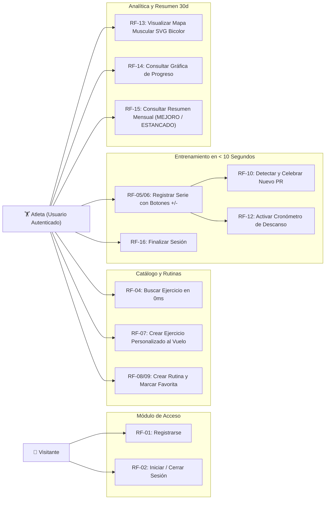
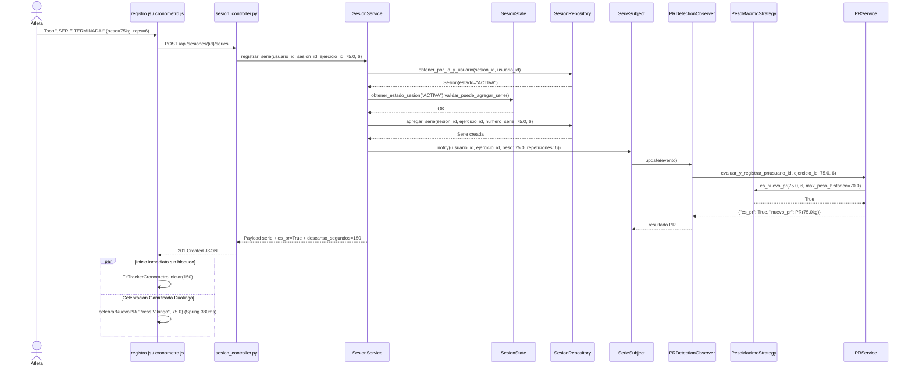
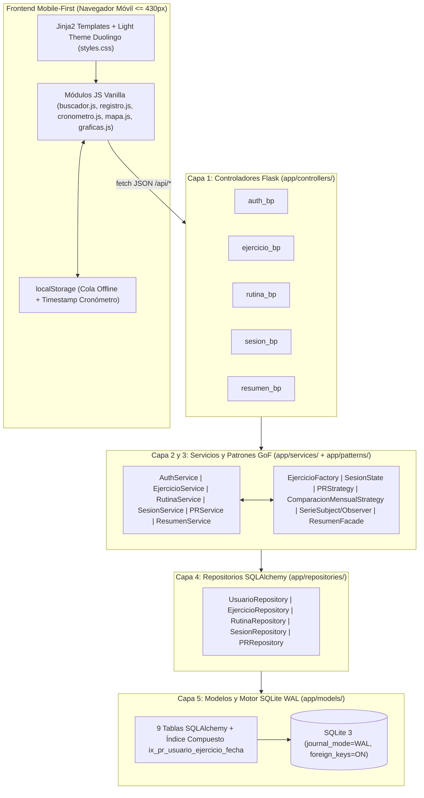

# Diagramas UML y de Arquitectura — FitTracker Web App

Este documento presenta el modelado arquitectónico de **FitTracker Web App** utilizando sintaxis oficial **Mermaid**.

---

## 1. Diagrama de Casos de Uso (Flujo del Atleta)

---

## 2. Diagrama de Clases UML (Modelos + 5 Patrones GoF)

```mermaid
classDiagram
    class Usuario {
        +int id
        +str nombre
        +str email
        +str password_hash
        +datetime fecha_registro
        +set_password(password)
        +check_password(password) bool
    }

    class Ejercicio {
        +int id
        +str nombre
        +bool es_predeterminado
        +int creado_por
    }

    class GrupoMuscular {
        +int id
        +str nombre
    }

    class EjercicioGrupo {
        +int id
        +int ejercicio_id
        +int grupo_muscular_id
        +bool es_primario
    }

    class Rutina {
        +int id
        +int usuario_id
        +str nombre
        +bool es_favorita
    }

    class Sesion {
        +int id
        +int usuario_id
        +int rutina_id
        +datetime fecha_inicio
        +datetime fecha_fin
        +str estado
    }

    class Serie {
        +int id
        +int sesion_id
        +int ejercicio_id
        +int numero_serie
        +float peso
        +int repeticiones
        +volumen() float
    }

    class PR {
        +int id
        +int usuario_id
        +int ejercicio_id
        +float peso
        +int repeticiones
        +str tipo_record
    }

    class EjercicioFactory {
        <<Factory Pattern>>
        +crear_predeterminado(nombre, primarios, secundarios)$ dict
        +crear_personalizado(nombre, usuario_id, primarios, secundarios)$ dict
    }

    class SesionState {
        <<State Pattern>>
        +validar_puede_agregar_serie(sesion)*
        +finalizar(sesion)* dict
    }

    class SesionActivaState {
        +validar_puede_agregar_serie(sesion)
        +finalizar(sesion) dict
    }

    class SesionFinalizadaState {
        +validar_puede_agregar_serie(sesion)
        +finalizar(sesion) dict
    }

    class PRStrategy {
        <<Strategy Pattern>>
        +es_nuevo_pr(peso, reps, max_peso, max_vol)* bool
    }

    class PesoMaximoStrategy {
        +es_nuevo_pr(peso, reps, max_peso, max_vol) bool
    }

    class VolumenSerieStrategy {
        +es_nuevo_pr(peso, reps, max_peso, max_vol) bool
    }

    class ComparacionMensualStrategy {
        <<Strategy Pattern>>
        +clasificar(sesiones_act, max_peso_act, max_vol_act, max_peso_prev, max_vol_prev) str
    }

    class SerieSubject {
        <<Observer Pattern>>
        +attach(observer)
        +notify(evento) list
    }

    class PRDetectionObserver {
        +update(evento) dict
    }

    class ResumenFacade {
        <<Facade Pattern>>
        +obtener_dashboard_mensual(usuario_id) dict
        +obtener_vista_mapa_muscular(usuario_id, dias) dict
        +obtener_vista_progreso_ejercicio(usuario_id, ejercicio_id) dict
    }

    Usuario "1" --> "*" Ejercicio : crea
    Usuario "1" --> "*" Rutina : posee
    Usuario "1" --> "*" Sesion : entrena
    Usuario "1" --> "*" PR : logra
    Ejercicio "1" --> "*" EjercicioGrupo : asocia
    GrupoMuscular "1" --> "*" EjercicioGrupo : clasifica
    Sesion "1" --> "*" Serie : contiene
    SesionState <|-- SesionActivaState
    SesionState <|-- SesionFinalizadaState
    PRStrategy <|-- PesoMaximoStrategy
    PRStrategy <|-- VolumenSerieStrategy
    SerieSubject --> PRDetectionObserver : notifica
    PRDetectionObserver --> PRStrategy : delega
    ResumenFacade --> ComparacionMensualStrategy : utiliza
```

---

## 3. Diagrama de Secuencia: Guardar Serie, Evaluación de PR y Cronómetro

---

## 4. Diagrama de Componentes y Arquitectura en Capas

